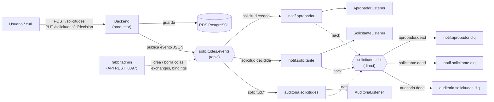
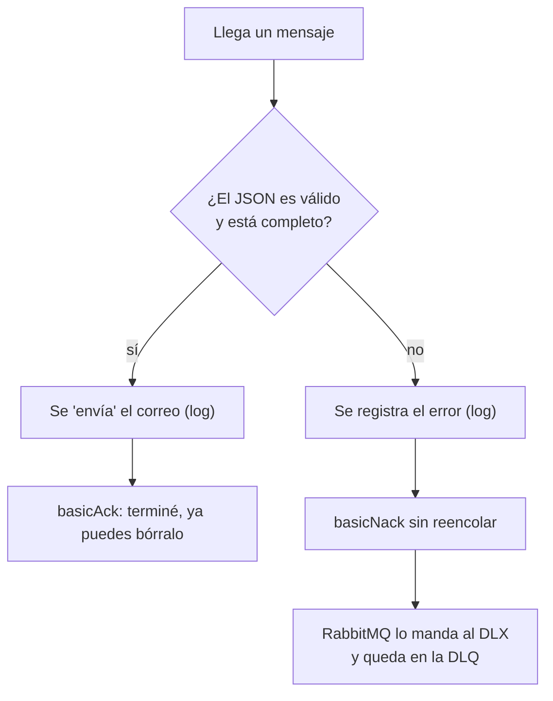

# DSY1107 PARCIAL2: Mensajería asíncrona con RabbitMQ

Esta etapa agrega RabbitMQ al sistema de solicitudes de vacaciones (solicitante / aprobador)
sin cambiar su lógica: crear y decidir una solicitud funciona igual que antes, y además
publica un evento que otros programas procesan por su cuenta.

## 1. Resumen

| Pieza | Qué es | Puerto |
|---|---|---|
| `rabbitmq/` | Cluster RabbitMQ de 3 nodos con docker-compose | 5672-5674 (AMQP), 15672-15674 (panel) |
| `backend/` | Servicio existente, ahora **productor** de eventos | 8080 |
| `notificaciones/` | Servicio nuevo, **consumidor** de los eventos | sin puerto HTTP: solo escucha colas |
| `rabbitadmin/` | Servicio nuevo, API REST para administrar colas, exchanges y bindings | 8097 |


RabbitMQ y los microservicios de esta etapa se ejecutan de forma local.
El backend y el frontend de la etapa 2 siguen desplegados en la nube sin cambios.

## 2. Rama de trabajo

Todo el trabajo está en la rama **`etapa3-rabbitmq`**, no en `main`.

- Los workflows de GitHub Actions solo se ejecutan con pushes a `main`, así que subir esta rama
  no despliega nada y el sistema desplegado en la nube queda intacto.
- Para verla: selector de ramas de GitHub → `etapa3-rabbitmq`, o
  `git checkout etapa3-rabbitmq`.
- Un merge a `main` desplegaría el backend nuevo en ECS, donde no existe RabbitMQ (ver sección 12).

## 3. Casos de uso y su propósito

El problema: cuando un solicitante crea una solicitud, el aviso al aprobador no debería
hacer esperar al usuario ni romper la creación si el servicio de avisos falla.
Con RabbitMQ el backend solo deja un mensaje y sigue; otro programa lo lee después.

| # | Evento | Quién lo procesa | Propósito |
|---|---|---|---|
| 1 | `solicitud.creada` | `AprobadorListener` | Avisar al aprobador que llegó una solicitud nueva |
| 2 | `solicitud.decidida` | `SolicitanteListener` | Avisar al solicitante la decisión y el comentario del aprobador |
| 3 | todos (`solicitud.*`) | `AuditoriaListener` | Dejar registro de cada evento del sistema |

Los "correos" son simulados: se escriben en el log. No hay servidor de correo real.

## 4. Arquitectura



Lectura del diagrama: las líneas continuas son el camino normal. Las líneas punteadas son el de error
(un mensaje rechazado va al exchange `solicitudes.dlx`, que lo deja en la DLQ de su cola).

## 5. Topología de RabbitMQ

**Exchanges**

| Nombre | Tipo | Función |
|---|---|---|
| `solicitudes.events` | topic | Recibe los eventos del backend y los reparte según la routing key |
| `solicitudes.dlx` | direct | Recibe los mensajes fallidos y los envía a la DLQ que corresponde |

**Colas** (todas *quorum*, es decir, replicadas en los tres nodos)

| Cola de trabajo | Binding (routing key) | DLQ | Routing key hacia la DLQ |
|---|---|---|---|
| `notif.aprobador` | `solicitud.creada` | `notif.aprobador.dlq` | `aprobador.dead` |
| `notif.solicitante` | `solicitud.decidida` | `notif.solicitante.dlq` | `solicitante.dead` |
| `auditoria.solicitudes` | `solicitud.*` | `auditoria.solicitudes.dlq` | `auditoria.dead` |

- Las colas de trabajo **no tienen time-to-live TTL**: un mensaje sale de ellas por ACK o por fallo, nunca por tiempo.
- Las DLQ tienen un TTL de 24 horas (`dlq-ttl-ms`) para limpiarse solas.
- `solicitud.*` coincide con una palabra después del punto, por eso `auditoria.solicitudes`
  recibe tanto `solicitud.creada` como `solicitud.decidida`. Es la razón de usar un exchange topic.

## 6. Cluster de RabbitMQ (`rabbitmq/`)

- 3 nodos (`rabbitmq-1`, `-2`, `-3`) con la imagen `rabbitmq:4-management`.
- La misma cookie de Erlang en los tres; un volumen propio por nodo.
- `rabbitmq.conf` lista los tres nodos para que formen el cluster.
- Los servicios se conectan con `spring.rabbitmq.addresses` a los tres nodos
  (`address-shuffle-mode: random`): si un nodo cae, se reconectan a otro.
- Se usan tres nodos y no dos porque con dos, al caer uno, no queda mayoría y las colas quorum se detienen.
  Tres nodos cumplen el requisito de "al menos dos nodos en cluster".

## 7. Estructura del proyecto (lo nuevo)

```
/
├── rabbitmq/
│   ├── docker-compose.yml          # cluster de 3 nodos
│   └── rabbitmq.conf               # formación del cluster
├── backend/                        # (existente, con cambios)
│   └── src/main/java/.../
│       ├── config/MensajeriaProperties.java   # nombres leídos de application.yaml
│       ├── config/RabbitMQConfig.java         # declara el exchange al que publica
│       ├── mensajeria/SolicitudEvento.java    # el mensaje (record)
│       ├── mensajeria/SolicitudEventPublisher.java  # el "Sender"
│       └── solicitudes/SolicitudController.java     # publica después de guardar
├── notificaciones/
│   └── src/main/java/.../
│       ├── config/MensajeriaProperties.java   # nombres desde application.yaml
│       ├── config/RabbitMQConfig.java         # exchanges, colas, DLQ y bindings
│       ├── evento/SolicitudEvento.java        # copia del evento, del lado consumidor
│       ├── evento/EventoParser.java           # JSON -> objeto + validación
│       ├── evento/EventoInvalidoException.java
│       └── listener/{Aprobador,Solicitante,Auditoria}Listener.java
└── rabbitadmin/
    └── src/main/java/.../
        ├── config/RabbitAdminConfig.java      # bean RabbitAdmin
        ├── controller/RabbitAdminController.java
        ├── service/RabbitAdminService.java    # toda la lógica de RabbitMQ
        ├── dto/{Queue,Exchange,Binding}Request.java, QueueInfoResponse.java
        └── exception/{RecursoNoEncontradoException,ManejadorDeErrores}.java
```

Los nombres de colas, exchanges y routing keys están escritos **una sola vez**, en el
`application.yaml` de cada servicio (sección `app.rabbit`). El código Java los lee, no los repite.

## 8. Backend como productor

- Después de **crear** una solicitud publica `solicitud.creada`; después de **decidirla**,
  `solicitud.decidida`. Ambos van al exchange `solicitudes.events`.
- Se publica **después de guardar**: nunca se anuncia una solicitud que no quedó en la base de datos.
- **Publicar nunca rompe la petición.** `SolicitudEventPublisher` atrapa cualquier error, lo escribe
  en el log (`[RABBIT] No se pudo publicar ...`) y la solicitud se crea igual.
- El indicador de salud de RabbitMQ está desactivado (`management.health.rabbit.enabled: false`),
  para que una caída de RabbitMQ no marque al backend como caído.
- Si RabbitMQ no responde, el backend deja de esperar a los 2 segundos (`connection-timeout: 2s`)
  y la petición sigue. Si el puerto está cerrado, el rechazo es inmediato.

Ejemplo de mensaje (JSON):

```json
{
  "messageId": "solicitud-5-creada",
  "tipo": "creada",
  "solicitudId": 5,
  "solicitanteEmail": "test@duoc.cl",
  "fechaInicio": "2026-12-20",
  "fechaFin": "2026-12-30",
  "estado": "PENDIENTE",
  "comentarioAprobador": null,
  "ocurridoEn": "2026-10-23T23:07:01Z"
}
```

`messageId` identifica el evento (una solicitud se crea una vez y se decide una vez), y está
pensado para detectar duplicados (ver sección 12).

## 9. Consumidor `notificaciones` y confirmación manual (ACK / NACK)

Cada `@RabbitListener` lee los mensajes de una **cola**, interpreta el JSON y decide explícitamente qué le dice a RabbitMQ:



| Respuesta del consumidor | Qué hace RabbitMQ |
|---|---|
| **ACK** (`basicAck`) | Borra el mensaje: se terminó de procesar |
| **NACK sin reencolar** (`basicNack(tag, false, false)`) | Lo manda al dead-letter exchange; llega a la DLQ de esa cola |
| Silencio (el consumidor cae) | RabbitMQ lo devuelve a la cola y lo entrega de nuevo |

- Configuración: `acknowledge-mode: manual` y `prefetch: 1` (un mensaje a la vez por consumidor).
- ACK **después** de terminar el trabajo: si el consumidor cae a medio camino, el mensaje no se pierde
  (entrega "al menos una vez"; un duplicado es posible).
- Un mensaje inválido (vacío, no es JSON, faltan campos) **no se reintenta**: reintentarlo siempre
  fallaría y se repetiría sin fin. Va a la DLQ y se deja en el log.
- Cada ACK y cada NACK se escribe en el log (`ACK enviado`, `NACK enviado sin reencolar`).
- Validación propia de `SolicitanteListener`: el evento debe estar `APROBADA` o `RECHAZADA`.
- Nadie consume las DLQ a propósito: los mensajes fallidos quedan visibles en el panel para revisarlos.

## 10. Administrador `rabbitadmin` (API REST, puerto 8097)

Permite crear y eliminar colas, exchanges y bindings **mientras RabbitMQ está en marcha**,
sin editar código ni reiniciar nada.

| Capa | Clase | Responsabilidad |
|---|---|---|
| Controlador | `RabbitAdminController` | Recibe la petición y llama al servicio. No conoce RabbitMQ |
| Servicio | `RabbitAdminService` | Toda la lógica de RabbitMQ, con `RabbitAdmin` de Spring |
| DTO | `QueueRequest`, `ExchangeRequest`, `BindingRequest` | Reglas de validación de la entrada |
| Errores | `ManejadorDeErrores` | Convierte cada fallo en un código HTTP honesto |

| Método y ruta | Cuerpo | Qué hace | Éxito |
|---|---|---|---|
| `POST /queues` | `{"name":"demo.cola","ttlMs":60000}` | Crea una cola quorum durable (`ttlMs` opcional) | 201 |
| `GET /queues/{name}` | — | Devuelve nombre, mensajes y consumidores | 200 |
| `DELETE /queues/{name}` | — | Borra la cola | 204 |
| `POST /exchanges` | `{"name":"demo.eventos","type":"topic"}` | Crea un exchange durable (`direct`, `topic` o `fanout`) | 201 |
| `DELETE /exchanges/{name}` | — | Borra el exchange | 204 |
| `POST /bindings` | `{"queue":"...","exchange":"...","routingKey":"..."}` | Une una cola a un exchange | 201 |
| `DELETE /bindings` | igual que el anterior | Quita el binding | 204 |

**Validación** (DTO con anotaciones, activada con `@Valid`):

- Nombre obligatorio, solo letras, números, `.`, `-`, `_`, máximo 255 caracteres.
- `ttlMs`, si viene, mayor que 0.
- Tipo de exchange: solo `direct`, `topic` o `fanout`.
- En bindings, `queue` y `exchange` obligatorios, y `routingKey` presente (puede ser vacía: un fanout la ignora).

Todas las colas que crea son **quorum**, regla de la clase. La respuesta de error de validación
lista cada campo con su mensaje.

## 11. Códigos HTTP del administrador

| Código | Significado | Cuándo ocurre |
|---|---|---|
| **200** | Todo bien, con respuesta | `GET /queues/{name}` de una cola que existe |
| **201** | Creado | Cola, exchange o binding declarado. Repetir la misma declaración también da 201 (declarar algo idéntico es inofensivo) |
| **204** | Hecho, sin cuerpo | Cualquier `DELETE` exitoso |
| **400** | La petición está mal formada | Falla una regla del DTO (nombre vacío o con caracteres inválidos, `ttlMs` ≤ 0, tipo de exchange no permitido, falta un campo) |
| **404** | No existe | `GET` o `DELETE` de una cola inexistente |
| **409** | Conflicto: RabbitMQ rechazó la operación | La cola ya existe con otros parámetros (`PRECONDITION_FAILED`), o un binding apunta a una cola/exchange inexistente (`NOT_FOUND`). El campo `detalle` trae el motivo de RabbitMQ |
| **503** | Servicio no disponible | No hay conexión con el cluster de RabbitMQ |

El tutorial original respondía "201 creada" aunque RabbitMQ rechazara la operación.
Aquí un rechazo nunca se informa como éxito.

## 12. Cómo levantar y probar

**Requisitos**: Docker Desktop abierto (contexto `desktop-linux`: `docker context show`),
Java 21, y la sesión del Learner Lab activa (el backend usa la base RDS).

```bash
# 1. Cluster
cd rabbitmq
docker compose up -d
docker compose ps                                  # los 3 nodos en "healthy"
docker exec rabbitmq-1 rabbitmqctl cluster_status  # 3 nodos en "Running Nodes"
# Panel: http://localhost:15672  (admin / admin123)

# 2. Consumidor (terminal propia)
cd notificaciones && ./mvnw spring-boot:run

# 3. Backend (terminal propia; necesita SPRING_DATASOURCE_PASSWORD)
cd backend && ./mvnw spring-boot:run

# 4. Administrador (terminal propia)
cd rabbitadmin && ./mvnw spring-boot:run
```

Obtener un token (el `client-id` sale de `terraform output env_frontend`):

```bash
TOKEN=$(aws cognito-idp initiate-auth --no-cli-pager \
  --auth-flow USER_PASSWORD_AUTH --client-id <CLIENT_ID> \
  --auth-parameters USERNAME=test@duoc.cl,PASSWORD=Duoc2026 \
  --query AuthenticationResult.AccessToken --output text)
```

### 12.1 Pruebas del cluster y de las colas

| Prueba | Comando o acción | Resultado esperado |
|---|---|---|
| Cluster formado | `docker exec rabbitmq-1 rabbitmqctl cluster_status` | Los 3 nodos en *Running Nodes*; *Alarms* y *Network Partitions* en `(none)` |
| Tres colas con su DLQ | Panel → *Queues and Streams* | 6 colas, todas tipo `quorum` |
| Exchanges direct y topic | Panel → *Exchanges* | `solicitudes.events` (topic) y `solicitudes.dlx` (direct) |
| Consumidores conectados | `docker exec rabbitmq-1 rabbitmqctl list_queues name consumers` | 1 consumidor en cada cola de trabajo, 0 en las DLQ |

### 12.2 Pruebas del flujo completo (productor → cola → consumidor)

Crear una solicitud en el backend local:

```bash
curl -s -w "\nHTTP %{http_code}\n" -X POST localhost:8080/solicitudes \
  -H "Authorization: Bearer $TOKEN" -H "Content-Type: application/json" \
  -d '{"fechaInicio":"2026-12-20","fechaFin":"2026-12-30","motivo":"prueba rabbit"}'
```

| Dónde mirar | Resultado esperado |
|---|---|
| Respuesta del curl | `201` con la solicitud en estado `PENDIENTE` |
| Log del backend | `[RABBIT] Evento publicado: solicitud.creada (solicitud-N-creada)` |
| Log de `notificaciones` | `[APROBADOR] Correo (simulado) al aprobador: nueva solicitud #N de ...`, luego `ACK enviado`; y `[AUDITORIA] Evento 'solicitud.creada' registrado` |

Decidirla con un token de `aprobador@duoc.cl`: `PUT localhost:8080/solicitudes/N/decision` con
`{"estado":"APROBADA","comentario":"ok"}` → en `notificaciones` aparece `[SOLICITANTE] Correo (simulado)`
con el comentario, más la auditoría. `[APROBADOR]` queda en silencio (esa routing key no coincide con su binding).

### 12.3 Pruebas de fallo y DLQ

Publicar desde el panel (*Exchanges → `solicitudes.events` → Publish message*, con routing key `solicitud.creada`):

| Payload | Resultado esperado |
|---|---|
| Un evento válido | Correo simulado y `ACK enviado`; nada queda esperando |
| *(vacío)* | `El mensaje está vacío` + `NACK enviado`; la DLQ de la cola crece en 1 |
| `esto no es json` | `El mensaje no es un JSON válido` + `NACK`; la DLQ crece en 1 |
| `{}` | `Al evento le faltan campos obligatorios` + `NACK`; la DLQ crece en 1 |
| Con `solicitud.decidida` y `"estado":"PENDIENTE"` | `SolicitanteListener` lo rechaza (DLQ del solicitante +1); `AuditoriaListener` lo acepta |

Como el exchange topic copia un mensaje a **todas** las colas que coinciden, un mensaje inválido
puede llenar varias DLQ a la vez (por ejemplo `solicitud.creada` llega a `notif.aprobador` y a `auditoria.solicitudes`).
Cada DLQ es independiente: un mensaje puede ser válido para una cola y rechazado por otra.

### 12.4 Pruebas de resiliencia

| Prueba | Pasos | Resultado esperado |
|---|---|---|
| **RabbitMQ caído no afecta al backend** | `docker compose stop`, crear una solicitud, luego `docker compose start` | La solicitud se guarda (aparece su `id`) y el log dice `[RABBIT] No se pudo publicar ...`. Esa solicitud no genera aviso |
| **Consumidor detenido: los mensajes esperan** | Detener `notificaciones` (Ctrl+C), crear 2-3 solicitudes, mirar el panel, volver a iniciar | Mientras está detenido, *Ready* crece en `notif.aprobador` y `auditoria.solicitudes`; al reiniciar se procesan todos y vuelve a 0 |
| **El backend se reconecta solo** | Después de levantar el cluster, crear una solicitud sin reiniciar el backend | `Created new connection` y `Evento publicado` |
| **Caída de un nodo** | `docker stop rabbitmq-2`; los otros dos mantienen la mayoría | Las colas siguen funcionando y no se pierden mensajes |

*Ready* son mensajes que nadie ha recibido todavía; *Unacked* son mensajes entregados a un consumidor que aún no confirmó.

### 12.5 Pruebas de `rabbitadmin`

Usar nombres de prueba (`demo.*`) y **no** borrar las seis colas del sistema.

| Prueba | Resultado esperado |
|---|---|
| `POST /exchanges` `{"name":"demo.eventos","type":"topic"}` | 201 y aparece en el panel |
| `POST /queues` `{"name":"demo.cola","ttlMs":60000}` | 201; en el panel, tipo `quorum` |
| `POST /bindings` cola `demo.cola`, exchange `demo.eventos`, key `demo.*` | 201 y aparece en el exchange |
| `GET /queues/demo.cola` | 200 `{"name":"demo.cola","messages":0,"consumers":0}`; con un mensaje publicado a `demo.hola`, `messages` pasa a 1 |
| `POST /queues` con `"name":""`, `"mi cola!"` o `"ttlMs":0` | 400 con el campo que falla |
| `POST /exchanges` con `"type":"headers"` | 400 `el tipo debe ser direct, topic o fanout` |
| `POST /queues` otra vez `demo.cola` con `"ttlMs":99999` | 409; `detalle` menciona `PRECONDITION_FAILED ... received '99999' but current is '60000'` |
| `POST /bindings` con una cola o exchange inexistente | 409; `detalle` menciona `NOT_FOUND` |
| `GET /queues/no.existe` | 404 |
| Con el cluster detenido, `GET /queues/demo.cola` | 503 `RabbitMQ no está disponible` |
| `DELETE /bindings`, `/queues/demo.cola` y `/exchanges/demo.eventos` | 204, y desaparecen del panel |

## 13. Decisiones y limitaciones

- **Sin autenticación en `rabbitadmin`**: cualquiera que llegue al puerto 8097 puede borrar cualquier cola,
  incluidas las del sistema. Aceptable en local; antes de llevarlo a la nube habría que protegerlo.
- **Eventos perdidos si RabbitMQ está caído**: la solicitud se guarda, pero su evento no se encola en ningún lado.
  La solución completa es el patrón *outbox* (guardar el evento en la base y publicarlo después); queda fuera del alcance.
- **Detección de duplicados**: el `messageId` ya viaja en cada evento, pero los consumidores todavía no
  descartan repetidos. Un duplicado es posible por la entrega "al menos una vez".
- **Backend en la nube**: el backend desplegado en ECS es el de la etapa 2. Si esta rama se mezclara con
  `main`, intentaría publicar en `localhost` y fallaría en silencio (la petición seguiría funcionando).
  Para evitarlo habría que fijar `APP_RABBIT_ENABLED=false` en `ecs.tf` o llevar RabbitMQ a la nube.
- **Nodos**: la rúbrica menciona dos nodos y las notas de la clase tres; se implementaron tres.


## 14. Evidencias

Las capturas de pantalla (cluster, colas, exchanges, DLQ, logs y respuestas de `rabbitadmin`)
se encuentran en el informe.
